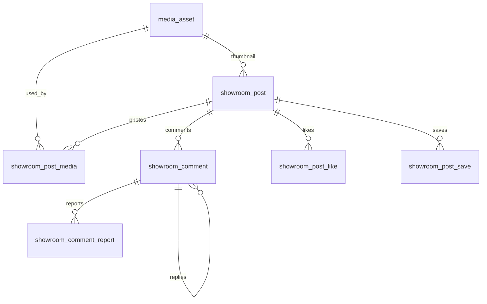

# 쇼룸 전체보기 게시글 스키마

PostgreSQL 15. 글의 머리, 본문, 사진 연결, 댓글, 좋아요, 저장만 서버에 둔다.

화면이 한 글을 통째로 읽고 통째로 갈아끼우므로 본문은 글 행의 JSON이다. 사진 파일만 따로 두어, 같은 파일이 대표 사진과 본문에 같이 걸려도 행은 하나다.

## 폰에만 있는 것

다른 사용자와 공유되지 않는 값은 컬럼으로 만들지 않는다.

| 화면 | 두는 곳 |
| --- | --- |
| 답글 숨기기 / 답글 N개 보기 | 그 폰의 댓글 id 집합. 접혀 있어도 답글 행은 서버에 그대로 있다 |
| 지금 답글을 다는 대상, 입력 중인 글 | 그 화면 |
| 댓글 시트를 열었는지 | 그 화면 |
| 참고 고르기 모드, 사진 위 잘라내기 | 상담으로 넘기기 전까지 그 화면. 상담 저장은 상담 쪽 데이터 |
| 키보드, 스크롤, 이모지 패널, 미리보기 높이 | 그 화면 |
| 베스트 댓글 2개 | 조회 결과. 플래그 컬럼 없음 |

답글 수는 컬럼이 아니다. 목록을 만들 때 그 글의 답글을 한 번 세어 응답에 실어 준다. 부모 댓글 행에 숫자를 복사해 두면, 답글이 달릴 때마다 그 부모 행을 잠근다.

댓글 수 합계도 글 행에 복사하지 않는다. 피드 정렬에 쓰이지 않고, 전체보기는 글 하나의 댓글만 세면 된다. 복사해 두면 댓글마다 글 행을 잠근다.

## 서버에 있는 것

| 값 | 이유 |
| --- | --- |
| 글 내리기 `unlisted` | 작성자가 내리면 모든 피드에서 빠진다 |
| 댓글 삭제 `deleted_at` | 그 댓글은 모든 화면에서 빠진다. 답글 접기와는 다르다 |
| 좋아요 수 | 피드가 여러 글을 이 수로 정렬한다. 글마다 `count(*)`를 하지 않으려고 글 행에 둔다 |
| 저장(하트) | 사용자마다 남고, 마이페이지와 다른 기기에서도 같다 |
| 신고 | 접수 기록이다. 화면을 닫아도 남아야 한다 |

하트는 저장이다. 커버의 숫자는 좋아요다. 지금 하트는 숫자를 바꾸지 않는다.

알고 가면 문단, 시공 전후의 구역 이름, Quill 델타는 저장하지 않는다. 본문 순서는 JSON 배열 순서다.

## 읽는 경로

테이블은 이 네 가지 읽기에 맞춘다.

**피드.** 블록을 읽지 않는다. 발행된 글의 머리, 대표 사진의 가로세로, 작성자, 이 사용자가 저장했는지만 한 페이지씩 읽는다. 저장한 글을 먼저 보여 주는 정렬은 사용자마다 달라서 인덱스 하나로 처리할 수 없다. 저장 구간과 나머지 피드를 나누어 읽고, 한 페이지 안에서 이어 붙인다.

**전체보기.** 글 행 하나(머리에 본문 JSON이 들어 있다), 그 JSON이 가리키는 사진 주소, 베스트 댓글 2개. 답글 본문은 아직 읽지 않는다. 각 댓글에 답글 수만 붙는다. 이 읽기는 페이지로 나누지 않는다.

**답글 펼치기.** 사용자가 그 댓글의 토글을 열면 `parent_id`로 그 답글의 첫 페이지를 읽는다. 더 있으면 같은 커서로 잇는다.

**수정.** 글 행의 JSON을 에디터로 되돌린다. 저장은 그 JSON을 통째로 바꾸고, 사진 연결 표를 같은 트랜잭션에서 다시 맞춘다.

## 페이지

글이 많아지면 목록은 잘라 읽는다. `offset`은 쓰지 않는다. 뒤 페이지일수록 앞에서 버린 행을 다시 읽고, 그 사이 좋아요가 바뀌면 같은 글이 빠지거나 두 번 나온다.

커서는 이번 페이지 마지막 행의 정렬 값이다. 다음 요청은 그 값보다 뒤에 있는 행만 읽는다. 정렬 값이 같으면 `id`로 가른다. 그래서 정렬 인덱스 맨 끝은 `id`다.

자르는 목록은 피드, 내가 쓴 글, 한 공간의 글, 댓글 시트, 펼친 답글이다. 글 한 편의 본문은 자르지 않는다. 블록을 나눠 읽으면 저장할 때 JSON을 통째로 갈아끼우는 경계가 없어진다.

피드에서 저장한 글은 앞에 온다. 요청은 지금 구간과 커서를 보내고, 응답은 이어서 붙인 한 페이지와 다음 구간·커서를 돌려준다. 저장 구간이 페이지를 다 못 채우면 같은 요청에서 나머지 피드를 잇는다. 그때 피드 커서는 비운다. 이미 앞에 둔 글은 피드 쪽에서 `not exists`로 빼서 다시 나오지 않게 한다. 로그인하지 않았으면 저장 구간 없이 피드만 읽는다. 더 없으면 커서는 비운다.

한 사용자의 저장만 피드 정렬로 다시 정렬한다. 그 정렬을 피드 인덱스에 사용자별로 넣지 않는다. 좋아요가 오를 때마다 저장한 사람 수만큼 인덱스를 다시 쓰게 된다.

## 테이블



### media_asset

파일 한 개. 주소는 저장하지 않는다. 스토리지 키로 API가 주소를 만든다. CDN 호스트가 바뀌어도 행을 고치지 않는다.

| 컬럼 | 타입 | 설명 |
| --- | --- | --- |
| id | uuid | |
| owner_user_id | uuid | 올린 사용자 |
| storage_key | text | 객체 키. 유일 |
| mime_type | text | 예: `image/jpeg` |
| byte_size | bigint | |
| width_px, height_px | int | 모르면 비운다 |
| aspect_ratio | numeric | 가로÷세로. 생성 컬럼. 피드 카드 높이. 없으면 앱은 0.8 |
| source_site_photo_id | uuid | 현장 공개 사진에서 왔으면 그 id. 직접 올리면 비운다 |
| created_at | timestamptz | |

### showroom_post

글 한 편. 필터와 피드에 쓰는 값은 컬럼이고, 본문은 `body`다.

| 컬럼 | 타입 | 설명 |
| --- | --- | --- |
| id | uuid | |
| author_id | uuid | 작성자 |
| project_id | uuid | 글을 연 내공간. 직접 쓰면 비운다. 한 공간에 글이 여러 개일 수 있다 |
| status | enum | `draft` 작성 중, `published` 피드, `unlisted` 작성자가 내림 |
| title | text | 발행된 글은 제목이 있어야 한다 |
| style_mood_id | text | 스타일 카드 id. 예: `mood_warm_natural`. 없으면 비운다 |
| thumbnail_media_id | uuid | 대표 사진. 피드가 이 값으로 사진을 찾는다 |
| industry_category_id | text | 업종 대분류. 예: `fnb` |
| industry_detail_id | text | 세부 업종. 예: `fnb_cafe` |
| area_pyeong | int | 평수. 없으면 비운다 |
| budget_won | bigint | 예산 원. 없으면 비운다. 0과 구분한다 |
| period_start, period_end | date | 시공 기간 |
| material_won, labor_won, expense_won | bigint | 자재비, 인력비, 경비. 셋 다 있거나 셋 다 비운다. 비우면 세부 공사비를 보여 주지 않는다 |
| cost_source | enum | 세부 공사비가 있을 때만 `manual` 또는 `quote` |
| quote_id | uuid | 견적서에서 불러왔을 때만 |
| city_name | text | 시 단위 동네. 예: `서울`. 프로젝트 주소에서 채운다. 없으면 비운다 |
| like_count | int | 좋아요 행 수와 같다. 피드 정렬용 |
| version | int | 수정 충돌. 읽었던 값과 같을 때만 저장된다 |
| body | jsonb | 아래 본문 |
| published_at | timestamptz | 처음 발행한 시각. 다시 발행해도 유지 |
| created_at, updated_at | timestamptz | |
| deleted_at | timestamptz | 소프트 삭제. 목록은 이 값이 빈 글만 본다 |

세부 공사비 합계는 세 칸을 더해 응답에 만든다. 글 행에 합계를 또 두지 않는다.

업종 이름과 스타일 카드 문구는 앱 카탈로그가 가지고, 글에는 id만 둔다. 분위기 태그도 카탈로그에 있다. 글마다 태그를 복사하지 않는다. 스타일 필터는 고른 카드 id로 건다.

평수와 예산은 숫자다. `50평`, `1,200만원`은 화면이 만든다.

### showroom_post_media

이 글이 쓰는 사진. 대표 사진과 본문에 나온 id를 모아 글당 파일당 한 행이다. 본문을 저장할 때 이 글의 행을 지우고 다시 넣는다.

파일을 지울 수 있는지는 이 표만 보면 된다. 대표 사진도 여기에 들어 있다.

| 컬럼 | 타입 | 설명 |
| --- | --- | --- |
| post_id | uuid | |
| media_id | uuid | |

기본 키는 `(post_id, media_id)`.

### showroom_comment

댓글과 답글. 답글은 한 단계다. 답글에 다시 답하면 클라이언트는 최상위 댓글 id를 `parent_id`로 보낸다.

| 컬럼 | 타입 | 설명 |
| --- | --- | --- |
| id | uuid | |
| post_id | uuid | |
| author_id | uuid | 이름과 프로필은 사용자에서 읽는다 |
| parent_id | uuid | 비우면 댓글. 있으면 그 댓글의 답글 |
| body | text | |
| created_at, updated_at | timestamptz | 내용을 고치면 `updated_at` |
| deleted_at | timestamptz | 모두에게서 뺀다 |

최상위 댓글을 지우면 같은 트랜잭션에서 답글의 `deleted_at`도 채운다.

### showroom_comment_report

| 컬럼 | 타입 | 설명 |
| --- | --- | --- |
| id | uuid | |
| comment_id | uuid | |
| reporter_id | uuid | |
| reason | enum | `spam` 스팸, `abuse` 욕설·비방, `ad` 광고, `other` 기타 |
| detail | text | |
| status | enum | `pending`, `reviewed`, `dismissed`. 운영 처리 상태 |
| created_at | timestamptz | |

한 사람의 한 댓글 신고는 한 행이다. 처리 전에 다시 보내면 이유와 내용만 덮어쓴다.

### showroom_post_like

좋아요. 기본 키 `(user_id, post_id)`. 넣고 빼는 트랜잭션에서 `like_count`를 같이 바꾼다.

`post_id`만 선두로 하는 인덱스는 두지 않는다. 누가 눌렀는지를 피드가 나열하지 않고, 수는 글 행에 있다. “내가 눌렀나”는 `(user_id, post_id)`로 찾는다.

### showroom_post_save

하트와 마이페이지 저장. 기본 키 `(user_id, post_id)`. 피드 한 페이지의 하트는 `user_id = 나 and post_id in (이 페이지)`로 찾는다.

## 본문

`body.blocks` 순서가 화면 순서다. 사진 자리에는 주소 대신 `media_asset.id`를 넣는다.

```json
{
  "blocks": [
    {
      "type": "text",
      "paragraphs": [
        {
          "align": "left",
          "runs": [
            {"text": "홀 조명은 ", "size": "medium", "bold": false},
            {"text": "4000K", "size": "medium", "bold": true}
          ]
        }
      ]
    },
    {"type": "images", "layout": "slider", "mediaIds": ["…", "…"]},
    {
      "type": "images",
      "layout": "before_after",
      "pairs": [
        {"beforeMediaId": "…", "afterMediaId": "…", "caption": ""}
      ]
    },
    {
      "type": "process",
      "frames": [
        {"trade": "목공", "mediaId": "…", "caption": "벽체 틀"}
      ]
    }
  ]
}
```

| type | layout | 내용 |
| --- | --- | --- |
| text | | 문단. `align`은 `left`, `center`, `right`. `size`는 `small`, `medium`, `large`. 이모지는 글자 |
| images | photo | `mediaIds` 1개 |
| images | slider, gallery | `mediaIds` 2개 이상 |
| images | before_after | `pairs`. 구역 이름 없음. 초안은 사진 id가 비어도 된다 |
| process | | `frames`의 공정, 사진, 캡션 |

글자가 없는 문단, 빈 전후, 공정·사진·캡션이 모두 빈 프레임은 저장 전에 빼다. 에디터를 다시 열면 칸 사이의 빈 글 자리는 그때 만든다.

발행 전에 앱이 확인한다. 제목이 있다. 내용 있는 블록이 하나 이상 있다. `photo`는 1장, `slider`와 `gallery`는 2장 이상이다.

## 저장과 수정

한 트랜잭션이다.

1. 없는 파일만 `media_asset`에 넣는다. 같은 `storage_key`가 있으면 그 행을 쓴다. 현장 사진이면 `source_site_photo_id`를 채운다.
2. 글을 넣거나, `id`와 `version`이 맞는 행만 고친다. 맞는 행이 없으면 다른 저장이 먼저 끝난 것이다.
3. `version`을 1 올리고 `body`를 교체한다.
4. `showroom_post_media`에서 이 글을 지우고, 대표 사진과 본문에 남은 id를 중복 없이 다시 넣는다.

발행은 `status = published`이고, `published_at`이 비어 있을 때만 지금 시각을 넣는다. 미리보기용 테이블은 없다. 미리보기는 초안이다.

이전 본문을 저장할 때마다 복사해 두지 않는다. 그 복사는 읽기에 쓰이지 않고, 저장마다 본문만큼의 쓰기가 한 번 더 생긴다. 충돌은 `version`으로 막는다.

## 댓글

전체보기 첫 화면은 최상위 댓글만 읽는다. 답글이 많은 순, 같으면 최근 순으로 2개다. 답글 수는 그 자리에서 센다.

```sql
select c.id, c.author_id, c.body, c.created_at,
       coalesce(r.reply_count, 0) as reply_count
from showroom_comment c
left join (
  select parent_id, count(*)::int as reply_count
  from showroom_comment
  where post_id = $1
    and parent_id is not null
    and deleted_at is null
  group by parent_id
) r on r.parent_id = c.id
where c.post_id = $1
  and c.parent_id is null
  and c.deleted_at is null
order by coalesce(r.reply_count, 0) desc, c.created_at desc
limit 2;
```

토글을 열면 그 부모의 답글을 오래된 순으로 한 페이지씩 읽는다.

```sql
select id, author_id, body, created_at
from showroom_comment
where parent_id = $1
  and deleted_at is null
  and (
    $cursor_at is null
    or (created_at, id) > ($cursor_at, $cursor_id)
  )
order by created_at, id
limit $limit;
```

전체 시트는 같은 조인으로 최상위를 최근 순 키셋으로 잇는다. 접힌 답글 본문은 포함하지 않는다.

```sql
select c.id, c.author_id, c.body, c.created_at,
       coalesce(r.reply_count, 0) as reply_count
from showroom_comment c
left join (
  select parent_id, count(*)::int as reply_count
  from showroom_comment
  where post_id = $1
    and parent_id is not null
    and deleted_at is null
  group by parent_id
) r on r.parent_id = c.id
where c.post_id = $1
  and c.parent_id is null
  and c.deleted_at is null
  and (
    $cursor_at is null
    or (c.created_at, c.id) < ($cursor_at, $cursor_id)
  )
order by c.created_at desc, c.id desc
limit $limit;
```

댓글 합계:

```sql
select count(*)
from showroom_comment
where post_id = $1
  and deleted_at is null;
```

답글을 달 때 부모가 같은 글의 살아 있는 최상위 댓글인지 트리거가 확인한다. 댓글은 발행된 글에만 단다.

신고 목록은 댓글 조회에 붙이지 않는다.

## 피드와 필터

한 페이지는 저장 구간을 먼저 읽고, 칸이 남으면 나머지 피드를 잇는다. 첫 요청은 구간이 `saved`이고 커서가 비어 있다.

저장 구간:

```sql
select p.id, p.title, p.city_name, p.like_count, p.published_at,
       p.style_mood_id, p.thumbnail_media_id
from showroom_post_save s
join showroom_post p on p.id = s.post_id
where s.user_id = $me
  and p.status = 'published'
  and p.deleted_at is null
  and p.published_at is not null
  and (
    $cursor_like is null
    or (p.like_count, p.published_at, p.id)
       < ($cursor_like, $cursor_published, $cursor_id)
  )
order by p.like_count desc, p.published_at desc, p.id desc
limit $limit;
```

나머지 피드. 저장 구간을 막 벗어난 요청은 커서가 비고, 리밋은 페이지에서 남은 칸이다. 이미 피드 구간이면 마지막 피드 행이 커서다.

```sql
select p.id, p.title, p.city_name, p.like_count, p.published_at,
       p.style_mood_id, p.thumbnail_media_id
from showroom_post p
where p.status = 'published'
  and p.deleted_at is null
  and p.published_at is not null
  and not exists (
    select 1
    from showroom_post_save s
    where s.user_id = $me
      and s.post_id = p.id
  )
  and (
    $cursor_like is null
    or (p.like_count, p.published_at, p.id)
       < ($cursor_like, $cursor_published, $cursor_id)
  )
order by p.like_count desc, p.published_at desc, p.id desc
limit $limit;
```

필터는 모두 선택이다. 없는 조건은 빼다. 있는 조건은 두 구간 모두에 붙인다. 평수·예산이 빈 글은 그 필터에 나오지 않는다.

- 동네: `city_name`
- 세부 업종: `industry_detail_id`
- 대분류만: `industry_category_id`
- 스타일: `style_mood_id = any(고른 카드)`
- 평수, 예산: 숫자 구간

평수와 예산에는 인덱스를 두지 않는다. 키셋은 정렬 인덱스로 들어간 뒤 걸러진다. 맞는 행이 드물면 한 페이지를 채우려고 인덱스를 더 내려간다. 인덱스를 더 만들면 좋아요가 오를 때마다 그 인덱스까지 다시 써야 한다. `like_count`가 들어 있는 인덱스는 피드용 하나뿐이다.

## 다른 도메인

이 마이그레이션은 아래 테이블을 만들지 않는다. 테이블이 생기면 DDL 맨 아래 외래 키를 추가한다.

| 컬럼 | 이어질 곳 |
| --- | --- |
| `author_id`, `owner_user_id`, `showroom_comment.author_id`, `reporter_id`, like와 save의 `user_id` | 사용자 |
| `project_id` | 내공간 프로젝트 |
| `quote_id` | 견적서 |
| `source_site_photo_id` | 현장 공개 사진 |
| 상담 참고 | 상담 쪽이 `showroom_post.id`와 `media_asset.id`를 가리킨다. 잘라낸 영역과 메모는 상담 쪽에 둔다 |

## 인덱스

좋아요가 글 행을 갱신하므로 `showroom_post` 인덱스는 실제 조회에만 둔다.

| 인덱스 | 조회 |
| --- | --- |
| `(like_count desc, published_at desc, id desc)` 발행·미삭제·발행 시각 있음 | 피드 키셋 |
| `(city_name)` 발행·미삭제·동네 있음 | 동네 |
| `(industry_detail_id)` 발행·미삭제·값 있음 | 세부 업종 |
| `(industry_category_id)` 같은 조건 | 업종 대분류 |
| `(style_mood_id)` 같은 조건 | 스타일 카드 |
| `(author_id, updated_at desc, id desc)` 미삭제 | 내가 쓴 글 키셋 |
| `(project_id, created_at desc, id desc)` 값 있음·미삭제 | 한 공간의 글 키셋 |
| `showroom_post_media (media_id)` | 이 파일을 쓰는 글, 파일 삭제 가능 여부 |
| 댓글 `(post_id, created_at desc, id desc)` 최상위·미삭제 | 댓글 시트 키셋 |
| 댓글 `(parent_id, created_at, id)` 답글·미삭제 | 펼친 답글 키셋 |
| 댓글 `(post_id)` 미삭제 | 댓글 합계 |

## DDL

```sql
create type showroom_post_status as enum ('draft', 'published', 'unlisted');
create type showroom_cost_source as enum ('manual', 'quote');
create type showroom_report_reason as enum ('spam', 'abuse', 'ad', 'other');
create type showroom_report_status as enum ('pending', 'reviewed', 'dismissed');

create table media_asset (
  id uuid primary key default gen_random_uuid(),
  owner_user_id uuid not null,
  storage_key text not null unique,
  mime_type text not null,
  byte_size bigint not null check (byte_size >= 0),
  width_px int check (width_px > 0),
  height_px int check (height_px > 0),
  aspect_ratio numeric(8, 5) generated always as (
    case
      when width_px is null or height_px is null or height_px = 0 then null
      else round(width_px::numeric / height_px::numeric, 5)
    end
  ) stored,
  source_site_photo_id uuid,
  created_at timestamptz not null default now()
);

create table showroom_post (
  id uuid primary key default gen_random_uuid(),
  author_id uuid not null,
  project_id uuid,
  status showroom_post_status not null default 'draft',
  title text not null default '',
  style_mood_id text,
  thumbnail_media_id uuid references media_asset (id) on delete restrict,
  industry_category_id text,
  industry_detail_id text,
  area_pyeong int check (area_pyeong is null or area_pyeong > 0),
  budget_won bigint check (budget_won is null or budget_won >= 0),
  period_start date,
  period_end date,
  material_won bigint,
  labor_won bigint,
  expense_won bigint,
  cost_source showroom_cost_source,
  quote_id uuid,
  city_name text,
  like_count int not null default 0 check (like_count >= 0),
  version int not null default 1 check (version > 0),
  body jsonb not null default '{"blocks":[]}'::jsonb,
  published_at timestamptz,
  created_at timestamptz not null default now(),
  updated_at timestamptz not null default now(),
  deleted_at timestamptz,
  check (period_start is null or period_end is null or period_start <= period_end),
  check (status <> 'published' or char_length(btrim(title)) > 0),
  check (jsonb_typeof(body -> 'blocks') = 'array'),
  check (
    (
      material_won is null and labor_won is null and expense_won is null
      and cost_source is null and quote_id is null
    )
    or (
      material_won >= 0 and labor_won >= 0 and expense_won >= 0
      and cost_source is not null
    )
  ),
  check (
    (cost_source = 'quote' and quote_id is not null)
    or (cost_source is distinct from 'quote' and quote_id is null)
  )
);

create index showroom_post_feed_idx
  on showroom_post (like_count desc, published_at desc, id desc)
  where status = 'published'
    and deleted_at is null
    and published_at is not null;

create index showroom_post_city_idx
  on showroom_post (city_name)
  where status = 'published' and deleted_at is null and city_name is not null;

create index showroom_post_industry_detail_idx
  on showroom_post (industry_detail_id)
  where status = 'published' and deleted_at is null and industry_detail_id is not null;

create index showroom_post_industry_category_idx
  on showroom_post (industry_category_id)
  where status = 'published' and deleted_at is null and industry_category_id is not null;

create index showroom_post_style_idx
  on showroom_post (style_mood_id)
  where status = 'published' and deleted_at is null and style_mood_id is not null;

create index showroom_post_author_idx
  on showroom_post (author_id, updated_at desc, id desc)
  where deleted_at is null;

create index showroom_post_project_idx
  on showroom_post (project_id, created_at desc, id desc)
  where project_id is not null and deleted_at is null;

create table showroom_post_media (
  post_id uuid not null references showroom_post (id) on delete cascade,
  media_id uuid not null references media_asset (id) on delete restrict,
  primary key (post_id, media_id)
);

create index showroom_post_media_media_idx
  on showroom_post_media (media_id);

create table showroom_comment (
  id uuid primary key default gen_random_uuid(),
  post_id uuid not null references showroom_post (id) on delete cascade,
  author_id uuid not null,
  parent_id uuid references showroom_comment (id) on delete cascade,
  body text not null check (char_length(btrim(body)) > 0),
  created_at timestamptz not null default now(),
  updated_at timestamptz not null default now(),
  deleted_at timestamptz
);

create index showroom_comment_root_idx
  on showroom_comment (post_id, created_at desc, id desc)
  where parent_id is null and deleted_at is null;

create index showroom_comment_reply_idx
  on showroom_comment (parent_id, created_at, id)
  where parent_id is not null and deleted_at is null;

create index showroom_comment_post_idx
  on showroom_comment (post_id)
  where deleted_at is null;

create or replace function showroom_comment_parent_is_root()
returns trigger
language plpgsql
as $$
begin
  if new.parent_id is null then
    return new;
  end if;

  if not exists (
    select 1
    from showroom_comment parent
    where parent.id = new.parent_id
      and parent.post_id = new.post_id
      and parent.parent_id is null
      and parent.deleted_at is null
  ) then
    raise exception 'reply parent must be a live root comment on the same post';
  end if;

  return new;
end;
$$;

create trigger showroom_comment_parent_is_root_trg
  before insert or update of parent_id, post_id
  on showroom_comment
  for each row
  execute function showroom_comment_parent_is_root();

create table showroom_comment_report (
  id uuid primary key default gen_random_uuid(),
  comment_id uuid not null references showroom_comment (id) on delete cascade,
  reporter_id uuid not null,
  reason showroom_report_reason not null,
  detail text not null check (char_length(btrim(detail)) > 0),
  status showroom_report_status not null default 'pending',
  created_at timestamptz not null default now(),
  unique (comment_id, reporter_id)
);

create table showroom_post_like (
  user_id uuid not null,
  post_id uuid not null references showroom_post (id) on delete cascade,
  created_at timestamptz not null default now(),
  primary key (user_id, post_id)
);

create table showroom_post_save (
  user_id uuid not null,
  post_id uuid not null references showroom_post (id) on delete cascade,
  created_at timestamptz not null default now(),
  primary key (user_id, post_id)
);
```

사용자, 프로젝트, 견적, 현장 사진 테이블이 준비되면 이름만 맞추어 추가한다.

```sql
alter table showroom_post
  add constraint showroom_post_author_fk
    foreign key (author_id) references app_user (id),
  add constraint showroom_post_project_fk
    foreign key (project_id) references space_project (id),
  add constraint showroom_post_quote_fk
    foreign key (quote_id) references work_quote (id);

alter table media_asset
  add constraint media_asset_owner_fk
    foreign key (owner_user_id) references app_user (id),
  add constraint media_asset_site_photo_fk
    foreign key (source_site_photo_id) references site_photo (id);

alter table showroom_comment
  add constraint showroom_comment_author_fk
    foreign key (author_id) references app_user (id);

alter table showroom_comment_report
  add constraint showroom_comment_report_reporter_fk
    foreign key (reporter_id) references app_user (id);

alter table showroom_post_like
  add constraint showroom_post_like_user_fk
    foreign key (user_id) references app_user (id);

alter table showroom_post_save
  add constraint showroom_post_save_user_fk
    foreign key (user_id) references app_user (id);
```
